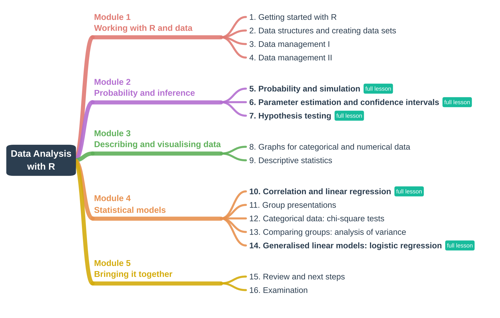

<style>
.module { margin-top: 1.6em; }
.session { border-left: 4px solid #d5dbe3; padding: 0.4em 0.6em 0.4em 0.9em; margin: 0.6em 0; }
.session p { margin: 0.2em 0; }
.session.full { border-left-color: #18bc9c; background: #f4fbf9; }
.stitle { font-weight: 600; font-size: 1.05em; color: #2c3e50; }
.session p { margin: 0.15em 0; }
.small { display:block; }
.tag { display: inline-block; font-size: 0.75em; font-weight: 600; padding: 0.05em 0.5em;
       border-radius: 3px; background: #18bc9c; color: white; margin-left: 0.4em; vertical-align: middle; }
.small { color: #555; font-size: 0.92em; }
</style>

## Course overview

*Data Analysis with R* is an undergraduate course I designed and introduced at
Renmin University of China. I taught it in spring 2024 and again, revised, in
spring 2025. It was offered as an elective open to students from across the
university, with classes of up to 68 students. A single class could include
students of music, journalism, sociology, statistics and physics. Most had
little mathematical background and had never programmed.

**Course goals.** By the end of the course, students can

- import, clean and manage a data set in R;
- describe and visualise data appropriately for the type of variable;
- explain the logic of estimation and hypothesis testing, and apply them;
- fit, interpret and critically evaluate linear and logistic regression models;
- report an analysis of their own data, with code, results and interpretation.

## Approach

Each session follows the same pattern:

1. **Start from something students can observe.** Before a formula appears,
   students run a small simulation or look at a plot and describe what they
   see.
2. **Connect the observation to the formal idea.** The definition or theorem
   then explains a pattern that students have already seen for themselves.
3. **Practise with data.** Short exercises ask students to change the code and
   reason about what happens, first on simulated data, then on real data.

Each session opens with a concept map that reviews the previous session and
places the new topic in the structure of the course, and closes with a
summary map, so that students see how the methods build on each other.

The classroom is meant as a place where students can voice their opinions and
discuss openly without fear of judgement; the teacher's role is that of a
facilitator.

R is used both for data analysis and as a laboratory for statistical ideas:
coverage rates, sampling distributions and error rates become things students
can count, not only definitions to memorise.

## Course map

<figure style="margin: 1em 0 1.5em 0;">

</figure>

Sixteen weekly sessions, in the order in which they were taught. Each teaching session links to its slides; sessions marked [full lesson]{.tag} are also available
as complete lessons with code, simulations, explanations and exercises.

### Module 1 · Working with R and data

::: {.session}
[1. Getting started with R]{.stitle}

**Objectives:** run code in RStudio, work with objects, scripts and packages, and reproduce a first small analysis.

[Topics: why R, R and RStudio, the workspace, packages, reusing output as input, a worked example.]{.small}

→ [Slides (PDF)](slides/01-getting-started-with-r.pdf)
:::

::: {.session}
[2. Data structures and creating data sets]{.stitle}

**Objectives:** choose an appropriate data structure and create or import a data set.

[Topics: vectors, matrices, arrays, data frames, factors and lists; types of variables; entering data; importing spreadsheets.]{.small}

→ [Slides (PDF)](slides/02-creating-a-data-set.pdf)
:::

::: {.session}
[3. Data management I]{.stitle}

**Objectives:** create and recode variables, and detect and handle missing values.

[Topics: arithmetic and logical operators, recoding a continuous variable into categories, renaming, `ifelse()`, missing values, type conversions.]{.small}

→ [Slides (PDF)](slides/03-data-management-1.pdf)
:::

::: {.session}
[4. Data management II]{.stitle}

**Objectives:** prepare an analysis data set from raw data.

[Topics: sorting, merging and subsetting data sets; a comprehensive exercise covering all data management steps, with solutions.]{.small}

→ [Slides (PDF)](slides/04-data-management-2.pdf)
:::

### Module 2 · Probability and inference

::: {.session .full}
[5. Probability and simulation]{.stitle} [full lesson]{.tag}

**Objectives:** understand probability as long-run frequency, work with common distributions, and see the central limit theorem happen.

[Topics: law of large numbers, binomial, Poisson and normal distributions, `d/p/q/r` functions, sampling distribution of the mean.]{.small}

→ [Open the lesson](01-probability-and-simulation.html) · [Slides (PDF)](slides/05-probability-and-distributions.pdf)
:::

::: {.session .full}
[6. Parameter estimation and confidence intervals]{.stitle} [full lesson]{.tag}

**Objectives:** explain what "95% confidence" refers to, and compute and interpret confidence intervals.

[Topics: chi-square, t and F distributions, the central limit theorem, point and interval estimation, repeated sampling and coverage.]{.small}

→ [Open the lesson](02-confidence-intervals.html) · [Slides (PDF)](slides/06-parameter-estimation.pdf)
:::

::: {.session .full}
[7. Hypothesis testing]{.stitle} [full lesson]{.tag}

**Objectives:** formulate hypotheses, compute test statistics and p-values, and explain what the significance level controls.

[Topics: rejection regions, z- and t-tests, one- and two-sided tests, Type I and Type II errors, error rates and power by simulation.]{.small}

→ [Open the lesson](03-hypothesis-testing.html) · [Slides (PDF)](slides/07-hypothesis-testing.pdf)
:::

### Module 3 · Describing and visualising data

::: {.session}
[8. Graphs for categorical and numerical data]{.stitle}

**Objectives:** choose a graph that matches the type of variable and the question.

[Topics: contingency tables, bar charts and spine plots, pie and fan charts, histograms and density curves, box and violin plots, scatter plots; an exercise on the `iris` data.]{.small}

→ [Slides (PDF)](slides/08-graphs.pdf)
:::

::: {.session}
[9. Descriptive statistics]{.stitle}

**Objectives:** summarise the centre, spread and shape of a distribution and choose suitable measures.

[Topics: mean, median, mode and quantiles; variance, standard deviation and coefficient of variation; standard scores; skewness and kurtosis. The group project is introduced in this session.]{.small}

→ [Slides (PDF)](slides/09-descriptive-statistics.pdf)
:::

### Module 4 · Statistical models

::: {.session .full}
[10. Correlation and linear regression]{.stitle} [full lesson]{.tag}

**Objectives:** fit, interpret and check simple and multiple regression models.

[Topics: Pearson and Spearman correlation, correlation versus causation, least squares, diagnostic plots, polynomial terms, the bias–variance trade-off, variable selection, multicollinearity.]{.small}

→ [Open the lesson](04-linear-regression.html) · [Slides (PDF)](slides/10-regression.pdf)
:::

::: {.session}
[11. Group presentations]{.stitle}

**Objectives:** present an analysis of a self-chosen data set and answer questions from peers.

[Each group receives feedback on its code, its visualisations and its choice of methods. Groups are encouraged to use AI tools, provided they share their prompts, and they answer questions live without them. Each group also reflects on what was hardest in the project and what they learned from it.]{.small}

:::

::: {.session}
[12. Categorical data: chi-square tests]{.stitle}

**Objectives:** test goodness of fit and independence, and check R's results by hand.

[Topics: contingency tables, expected counts, the chi-square distribution, `chisq.test()`, an application to survey data on gender attitudes.]{.small}

→ [Slides (PDF)](slides/12-chi-square-tests.pdf)
:::

::: {.session}
[13. Comparing groups: analysis of variance]{.stitle}

**Objectives:** explain ANOVA as a comparison of between- and within-group variation, and follow up on a significant result.

[Topics: simulated groups with small and large within- and between-group variance, sums of squares, the F test, Tukey's HSD, Levene's test, the Kruskal–Wallis test.]{.small}

→ [Slides (PDF)](slides/13-anova.pdf)
:::

::: {.session .full}
[14. Generalised linear models: logistic regression]{.stitle} [full lesson]{.tag}

**Objectives:** model a binary outcome, interpret odds ratios and evaluate predictions on new data.

[Topics: a look back at which method fits which type of outcome and predictor, leading to models for outcomes that are not normal; maximum likelihood, introduced through a scene from the TV drama *Lurk* (潜伏) in which the main characters find a stranger's footprints in their home and weigh the possible explanations; AIC and BIC, log-odds and odds ratios, predicted probabilities, classification, sensitivity and specificity.]{.small}

→ [Open the lesson](05-logistic-regression.html) · [Slides (PDF)](slides/14-generalised-linear-models.pdf)
:::

### Module 5 · Bringing it together

::: {.session}
[15. Review and next steps]{.stitle}

**Objectives:** connect the methods of the course and look ahead to `ggplot2` and to data science more broadly.

[Topics: a concept map of the whole course; a first look at `ggplot2` through a video tutorial; data science more broadly, closing with a music video on data science.]{.small}

:::

::: {.session}
[16. Examination]{.stitle}

**Objectives:** apply the course methods independently to short analysis problems in R, in an open-note examination.

:::

## How the methods fit together

Session 14 opens by looking back at the methods so far, organised by the type
of outcome and predictor. The open question, what to do when the outcome is not
normal, leads into generalised linear models:

| Outcome | Predictor | Method in this course |
|---|---|---|
| Categorical | Categorical | Chi-square test (session 12) |
| Numerical | Categorical | t-test, analysis of variance (sessions 7 and 13) |
| Numerical | Numerical | Simple, multiple and polynomial regression (session 10) |
| Binary or otherwise non-normal | Any | Generalised linear models, e.g. logistic regression (session 14) |

## Assessment and course design

The final grade combines **coursework (40%)** and an **open-note
examination (60%)**.

- **Exercises in every session.** Sessions end with tasks that ask students to
  modify the code and explain the result in words; longer exercises, such as
  the data management exercise in session 4, come with worked solutions.
- **Group project.** In groups of four to six, students analyse a data set of
  their own choice that contains at least one categorical and one numerical
  variable. They import it into R, choose two or three suitable graphs (at
  least one made with `ggplot2`), describe the centre, spread and shape of the
  distributions, and present their code, results and interpretation in a
  ten-minute presentation. Presentations are graded individually as well as by
  group.
- **Written assignments.** Each group receives written feedback on its
  interpretation and on the validity and limitations of its models, along with
  answers to the questions the group raised.
- **Open-note examination** with short analysis problems in R.

**Teaching students with mixed quantitative backgrounds.** Simulation lets
students without much mathematics see a result before they meet its formal
statement, while the formal statement is always given for students who want it.
Code is provided as worked examples that students change step by step rather
than write from scratch. Optional "thinking questions" in the assignments give
stronger students room to go further.

## Open teaching materials

The lesson sources are available on
[GitHub](https://github.com/jinjiayun57/data-analysis-with-r) as R Markdown
files; each lesson page also has a **Code** button to download its source. The
data are simulated or come from packages that ship with R, so every lesson runs
as it is:

```r
install.packages(c("rmarkdown", "ggplot2", "RColorBrewer", "MASS", "car"))
```

Lesson text, code and figures are licensed under
[CC BY 4.0](https://creativecommons.org/licenses/by/4.0/) (text and figures)
and the MIT License (code). You are welcome to reuse and adapt them; please
credit the source.

The slides (LaTeX Beamer, in Chinese and English as taught in 2025) are shared
for viewing and teaching use with attribution. They are not covered by the CC
BY licence, and any third-party images in them remain the property of their
owners.
